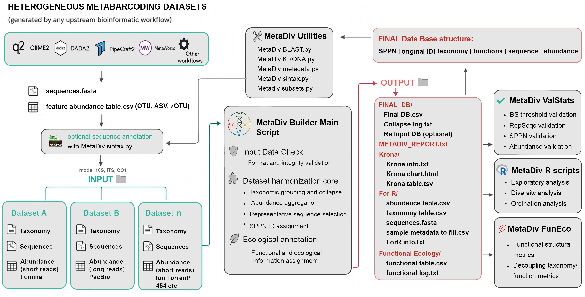

<p align="center">
  
</p>

# MetaDiv Builder v1.8.2

### A modular framework for metabarcoding data integration, taxonomic harmonization, ecological annotation, and biodiversity analysis

**MetaDiv Builder** is an open-source computational framework designed to transform heterogeneous metabarcoding outputs into standardized, traceable, and analysis-ready biodiversity databases.

The platform integrates feature abundance tables, representative DNA sequences, and SINTAX taxonomic classifications into a unified workflow, supporting multiple molecular markers (**ITS, 16S rRNA, and COI**) and datasets generated by different sequencing technologies and bioinformatic pipelines.

A central component of MetaDiv Builder is the implementation of **Species Placeholder Numbers (SPPNs)**, which provide standardized identifiers for taxonomic units while preserving traceability to the underlying molecular data.

MetaDiv Builder supports configurable taxonomic confidence thresholds, multiple taxonomic collapsing strategies, abundance aggregation, representative sequence selection, ecological annotation, and standardized exports for downstream biodiversity analyses.

The framework also includes independent modules for functional ecology, validation, taxonomic visualization, sequence comparison, metadata integration, and community ecology analyses in R.

---

## Table of Contents

1. [Features](#features)
2. [Framework Architecture](#framework-architecture)
3. [Workflow](#workflow)
4. [Installation](#installation)
5. [Quick Start](#quick-start)
6. [Command-Line Interface](#command-line-interface)
7. [Input Requirements](#input-requirements)
8. [Directory Structure](#directory-structure)
9. [Taxonomic Harmonization](#taxonomic-harmonization)
10. [Output Structure](#output-structure)
11. [Ecological Annotation](#ecological-annotation)
12. [MetaDiv FunEco](#metadiv-funeco)
13. [MetaDiv ValStats](#metadiv-valstats)
14. [MetaDiv Utilities](#metadiv-utilities)
15. [Integration with R](#integration-with-r)
16. [Documentation](#documentation)
17. [Reproducibility](#reproducibility)
18. [Citation](#citation)
19. [License](#license)
20. [Authors](#authors)

---

# Features

### Multi-marker integration

MetaDiv Builder supports three major metabarcoding markers:

- **ITS:** Fungi and other eukaryotes.
- **16S rRNA:** Bacteria and other prokaryotes.
- **COI / CO1:** Metazoans and other eukaryotes.

### Taxonomic harmonization

- Automatic discovery of complete input datasets.
- Integration of OTUs, ASVs, zOTUs, and other molecular features.
- Taxonomic classification based on SINTAX assignments.
- Configurable bootstrap-score confidence thresholds.
- Species-, genus-, and recursive taxonomic collapsing.
- Species Placeholder Number (SPPN) assignment.
- Abundance aggregation.
- Representative sequence selection.
- Taxonomic traceability through collapse logs.

### Ecological annotation

- FungalTraits integration for ITS datasets.
- FAPROTAX integration for 16S datasets.
- Functional annotation and ecological characterization.
- Functional structural metrics through MetaDiv FunEco.

### Standardized exports

- Final biodiversity databases.
- R-compatible abundance and taxonomy tables.
- Representative sequences.
- MetaDiv-compatible ReInput datasets.
- Krona-compatible taxonomic abundance tables.
- Functional ecology annotations.
- Processing reports and collapse logs.

### Additional modules

- MetaDiv FunEco.
- MetaDiv ValStats.
- MetaDiv Utilities.
- MetaDiv R Scripts.

### Data processing

- Chunk-based processing of large abundance tables.
- RAM-aware data handling.
- Configurable output generation.
- Optional preservation of intermediate files through Developer Mode.

---

# Framework Architecture

MetaDiv Builder v1.8.2 is organized into four principal components:

| Component | Description |
|---|---|
| **MetaDiv Builder Core** | Integrates and harmonizes heterogeneous metabarcoding datasets. |
| **MetaDiv FunEco** | Calculates fungal functional structure and taxonomic-functional relationship metrics. |
| **MetaDiv ValStats** | Evaluates the internal consistency of database construction and taxonomic harmonization. |
| **MetaDiv Utilities** | Provides complementary tools for taxonomy, sequence comparison, visualization, metadata, and subsets. |

An additional collection of **MetaDiv R Scripts** supports downstream biodiversity and community ecology analyses.

## Framework diagram

<p align="center">
  
</p>

---

# Workflow

The MetaDiv Builder workflow consists of six main stages.

## 1. Input preparation

MetaDiv Builder accepts metabarcoding datasets generated by pipelines such as:

- QIIME2
- DADA2
- PipeCraft2
- MetaWorks
- Other workflows producing compatible abundance, taxonomy, and sequence files.

Input data may originate from sequencing platforms such as Illumina, PacBio, Ion Torrent, or 454, provided they are converted into the required formats.

Each dataset must contain:

1. Feature abundance table.
2. SINTAX taxonomic classification.
3. Representative DNA sequences.

## 2. Taxonomic annotation

Representative sequences can be classified using the **MetaDiv_sintax** utility, which implements the SINTAX algorithm through VSEARCH.

For taxonomic consistency, datasets intended for integration should preferably be annotated using the same taxonomic reference database for each molecular marker.

Recommended reference databases include:

| Molecular marker | Reference database |
|---|---|
| ITS | EUKARYOME ITS v2.0 |
| 16S rRNA | 16S-ITGDB |
| COI | MIDORI2 |

Reference database information and download instructions are provided in:

[Taxonomic Reference Databases](databases/taxonomic_reference_db/README.md)

## 3. Taxonomic harmonization

The main MetaDiv Builder script performs:

- Input validation.
- Dataset integration.
- Taxonomic grouping.
- Confidence-based collapsing.
- Abundance aggregation.
- Representative sequence selection.
- SPPN assignment.

## 4. Ecological annotation

When enabled, marker-specific ecological annotation modules incorporate functional information from:

- FungalTraits for ITS.
- FAPROTAX for 16S.

## 5. Database construction and export

MetaDiv Builder produces standardized biodiversity databases and complementary export packages.

These outputs preserve taxonomic information and provide data structures for downstream analyses.

## 6. Downstream analyses

Generated databases can be processed using:

- MetaDiv FunEco.
- MetaDiv ValStats.
- MetaDiv R Scripts.
- MetaDiv Utilities.
- Other compatible statistical and ecological analysis tools.

### Workflow overview

```text
Metabarcoding datasets
          |
          v
Input preparation
          |
          v
SINTAX taxonomic annotation
          |
          v
MetaDiv Builder Core
          |
          +--> Taxonomic harmonization
          |
          +--> Confidence-based collapsing
          |
          +--> SPPN assignment
          |
          +--> Abundance aggregation
          |
          v
Standardized Final Database
          |
          +--> Ecological annotation
          |
          +--> R-compatible exports
          |
          +--> Krona-compatible exports
          |
          +--> ReInput datasets
          |
          +--> Processing reports
          |
          v
Downstream modules
          |
          +--> MetaDiv FunEco
          |
          +--> MetaDiv ValStats
          |
          +--> MetaDiv Utilities
          |
          +--> MetaDiv R Scripts
```

---

# Installation

MetaDiv Builder provides a Conda environment containing the principal Python and R dependencies.

## 1. Install Miniconda

Download and install Miniconda:

https://www.anaconda.com/download

## 2. Clone the repository

Open a terminal, Anaconda Prompt, or compatible command-line interface.

```bash
git clone https://github.com/Burn121212/MetaDiv_Builder.git
```

Navigate to the project directory:

```bash
cd MetaDiv_Builder
```

## 3. Create the Conda environment

```bash
conda env create -f metadiv_environment.yml
```

## 4. Activate the environment

```bash
conda activate metadiv
```

The environment configuration includes:

- Python 3.12.
- NumPy.
- pandas.
- PyArrow.
- Matplotlib.
- JupyterLab.
- Jupyter Notebook.
- R 4.5.
- vegan.
- ggplot2.
- dplyr.
- Additional Python and R dependencies.

Some companion utilities may require external software or additional packages, as described in their corresponding documentation.

### Operating systems

The framework is intended for use on Windows, Linux, and macOS through compatible Python and Conda environments.

Platform-specific compatibility should be verified for the installed dependencies and optional external tools.

---

# Quick Start

MetaDiv Builder can be executed through Jupyter Notebook or the Python command-line interface.

## Option A. Jupyter Notebook

Activate the environment:

```bash
conda activate metadiv
```

Launch Jupyter Notebook:

```bash
jupyter notebook
```

Open:

```text
MetaDiv_Builder_v1_8_2_MAIN_SCRIPT.ipynb
```

Review the configuration parameters, select the molecular marker, and execute the notebook.

## Option B. Python command-line interface

Activate the environment:

```bash
conda activate metadiv
```

Run the main script:

```bash
python MetaDiv_Builder_v1_8_2_MAIN_SCRIPT.py --mode ITS
```

Display the complete command-line options:

```bash
python MetaDiv_Builder_v1_8_2_MAIN_SCRIPT.py --help
```

The default marker is ITS, and the default taxonomic collapsing strategy is `species_only`.

The main script automatically searches for the corresponding input datasets within the marker-specific input directory.

---

# Command-Line Interface

MetaDiv Builder v1.8.2 supports configurable execution parameters.

The examples below use multiline Bash syntax for Linux and macOS. On Windows CMD, use a single line or replace the line-continuation character `\` with `^`.

## Example 1. ITS — all eukaryotes

Strict species-level taxonomic collapsing:

```bash
python MetaDiv_Builder_v1_8_2_MAIN_SCRIPT.py \
  --mode ITS \
  --subset-mode all_eukaryotes \
  --collapse-strategy species_only \
  --bs-collapse-threshold 1.0 \
  --sppn-bs-threshold 0.8
```

## Example 2. ITS — fungi only

Recursive taxonomic collapsing:

```bash
python MetaDiv_Builder_v1_8_2_MAIN_SCRIPT.py \
  --mode ITS \
  --subset-mode only_fungi \
  --collapse-strategy all \
  --bs-collapse-threshold 0.8
```

## Example 3. ITS — genus-level collapsing

```bash
python MetaDiv_Builder_v1_8_2_MAIN_SCRIPT.py \
  --mode ITS \
  --subset-mode all_eukaryotes \
  --collapse-strategy genus \
  --bs-collapse-threshold 0.8
```

## Example 4. 16S — bacteria with FAPROTAX

```bash
python MetaDiv_Builder_v1_8_2_MAIN_SCRIPT.py \
  --mode 16S \
  --subset-mode only_bacteria \
  --run-faprotax-16s
```

## Example 5. COI — metazoans

```bash
python MetaDiv_Builder_v1_8_2_MAIN_SCRIPT.py \
  --mode CO1 \
  --subset-mode only_metazoa \
  --no-dev-mode
```

The main script uses `CO1` as the directory and marker identifier. `COI` is also accepted as an alias for the command-line marker argument.

## Example 6. ITS with functional annotation and Krona export

```bash
python MetaDiv_Builder_v1_8_2_MAIN_SCRIPT.py \
  --mode ITS \
  --subset-mode all_eukaryotes \
  --collapse-strategy genus \
  --run-fungaltraits-its \
  --fungal-traits-db databases/ecological_reference_db/Fungal_Traits_DB.txt \
  --run-krona-export \
  --no-run-krona-per-sample-export
```

## Example 7. Developer Mode

Developer Mode preserves intermediate files that can be used for validation and debugging.

```bash
python MetaDiv_Builder_v1_8_2_MAIN_SCRIPT.py \
  --mode ITS \
  --dev-mode
```

Developer Mode must be enabled when preparing datasets for MetaDiv ValStats.

## Example 8. Custom project directory

```bash
python MetaDiv_Builder_v1_8_2_MAIN_SCRIPT.py \
  --project-dir /path/to/metadiv_project \
  --mode ITS
```

## Principal parameters

| Parameter | Description | Default |
|---|---|---|
| `--mode` | Molecular marker: ITS, 16S, CO1 | ITS |
| `--subset-mode` | Marker-specific taxonomic subset | Depends on marker |
| `--collapse-strategy` | Taxonomic collapsing strategy | species_only |
| `--bs-collapse-threshold` | SINTAX bootstrap threshold for collapsing | 1.0 |
| `--sppn-bs-threshold` | Bootstrap threshold for SPPN assignment | 0.8 |
| `--dev-mode` | Preserve intermediate development files | Disabled |
| `--run-fungaltraits-its` | Enable ITS FungalTraits annotation | Enabled |
| `--run-faprotax-16s` | Enable 16S FAPROTAX annotation | Disabled |
| `--run-krona-export` | Generate Krona-compatible tables | Enabled |
| `--run-krona-per-sample-export` | Generate per-sample Krona tables | Disabled |
| `--run-for-r-export` | Generate R-compatible export packages | Enabled |
| `--project-dir` | Define custom project directory | Auto-detected |
| `--output-root` | Define output root directory | PROJECT_DIR/output |

Legacy aliases such as `--p-value-threshold` and `--sppn-p-threshold` remain accepted in v1.8.2. The preferred parameter names are `--bs-collapse-threshold` and `--sppn-bs-threshold`.

For additional parameters:

```bash
python MetaDiv_Builder_v1_8_2_MAIN_SCRIPT.py --help
```

---

# Input Requirements

Each dataset must include three files sharing the same dataset prefix.

```text
DatasetName_abundance.csv
DatasetName_taxonomy.sintax.txt
DatasetName_sequences.fasta
```

## 1. Abundance table

A CSV file containing molecular feature abundances across samples.

Features may represent:

- OTUs.
- ASVs.
- zOTUs.
- Other molecular operational taxonomic units.

Feature identifiers must be consistent with those used in the taxonomy and representative sequence files.

## 2. Taxonomy file

A SINTAX-formatted taxonomy file containing taxonomic classifications and confidence information.

Required filename suffix:

```text
_taxonomy.sintax.txt
```

If taxonomic classifications are unavailable, they can be generated using MetaDiv_sintax.

## 3. Representative sequences

A FASTA file containing representative DNA sequences.

Required filename suffix:

```text
_sequences.fasta
```

Sequence identifiers must correspond to the molecular features represented in the input datasets.

## Input directory organization

Input files must be placed in the corresponding molecular marker directory.

```text
input/
|
+-- ITS/
|   +-- Dataset_abundance.csv
|   +-- Dataset_taxonomy.sintax.txt
|   +-- Dataset_sequences.fasta
|
+-- 16S/
|   +-- Dataset_abundance.csv
|   +-- Dataset_taxonomy.sintax.txt
|   +-- Dataset_sequences.fasta
|
+-- CO1/
    +-- Dataset_abundance.csv
    +-- Dataset_taxonomy.sintax.txt
    +-- Dataset_sequences.fasta
```

The repository includes example datasets for all three supported molecular markers.

---

# Directory Structure

The following structure represents the principal directories and scripts included in MetaDiv Builder v1.8.2.

```text
MetaDiv_Builder/
|
+-- MetaDiv_Builder_v1_8_2_MAIN_SCRIPT.py
+-- MetaDiv_Builder_v1_8_2_MAIN_SCRIPT.ipynb
|
+-- MetaDiv_FunEco/
|   +-- MetaDiv_FunEco_SCRIPT.ipynb
|   +-- README.md
|
+-- MetaDiv_ValStats/
|   +-- MetaDiv_ValStats_SCRIPT.ipynb
|   +-- README.md
|
+-- MetaDiv_R_scripts/
|   +-- 00_MetaDiv_create_phyloseq.R
|   +-- 01_MetaDiv_explorer_alpha_portable.R
|   +-- 02_MetaDiv_ordination_NMDS_Hellinger_taxglom_portable.R
|   +-- 03_MetaDiv_iNEXT_Hill_Numbers_portable.R
|   +-- check_environment.R
|
+-- MetaDiv_Utilies/
|   |
|   +-- MetaDiv_BLAST/
|   |   +-- MetaDiv_BLAST.ipynb
|   |   +-- query/
|   |   +-- README.md
|   |
|   +-- MetaDiv_KRONA/
|   |   +-- MetaDiv_KRONA.py
|   |   +-- MetaDiv_KRONA.ipynb
|   |   +-- input_KRONA/
|   |   +-- README.md
|   |
|   +-- MetaDiv_metadata/
|   |   +-- MetaDiv_metadata.ipynb
|   |   +-- source_metadata/
|   |   +-- README.md
|   |
|   +-- MetaDiv_sintax/
|   |   +-- MetaDiv_sintax.py
|   |   +-- MetaDiv_sintax.ipynb
|   |   +-- README.md
|   |
|   +-- MetaDiv_subsets/
|   |   +-- MetaDiv_subset.ipynb
|   |   +-- query_lists/
|   |   +-- README.md
|   |
|   +-- README.md
|
+-- databases/
|   +-- ecological_reference_db/
|   |   +-- FAPROTAX.txt
|   |   +-- Fungal_Traits_DB.txt
|   |
|   +-- taxonomic_reference_db/
|       +-- README.md
|
+-- input/
|   +-- ITS/
|   +-- 16S/
|   +-- CO1/
|   +-- REAMDE.md
|
+-- docs/
|   +-- Diagram_Structure_MetaDiv_Builder.png
|   +-- METADIV BUILDER LOGO V1.png
|   +-- MetaDiv Builder Platform.docx
|   +-- MetaDiv Builder structure.txt
|
+-- metadiv_environment.yml
+-- LICENSE
+-- README.md
```

**Note:** `MetaDiv_Utilies` and `input/REAMDE.md` are retained here with their existing repository names to preserve working paths and links.

The `output/` directory is generated during execution and is not included among the source directories in the v1.8.2 distribution.

---

# Taxonomic Harmonization

MetaDiv Builder implements taxonomic collapsing strategies to standardize heterogeneous molecular features.

The collapsing process is controlled by taxonomic assignments and their associated SINTAX confidence scores.

## Species-only strategy

```text
--collapse-strategy species_only
```

Taxonomic collapsing is performed at the species level when the corresponding assignment satisfies the configured confidence threshold.

This strategy is useful when prioritizing strict species-level taxonomic assignments.

## Genus strategy

```text
--collapse-strategy genus
```

The workflow groups molecular features according to genus-level taxonomic assignments.

This strategy supports genus-level comparisons among datasets.

## Recursive strategy

```text
--collapse-strategy all
```

The workflow performs taxonomic collapsing across supported taxonomic ranks according to the available classification and confidence thresholds.

This strategy is described conceptually as a lowest-confident-rank approach.

**Important:** The accepted CLI argument for this strategy in v1.8.2 is `all`, not `lowest_rank`.

## Bootstrap confidence thresholds

The taxonomic collapsing threshold is configured using:

```text
--bs-collapse-threshold
```

The SPPN assignment threshold is configured separately:

```text
--sppn-bs-threshold
```

Both parameters accept values between 0 and 1.

These values represent SINTAX bootstrap confidence thresholds, not statistical p-values.

---

# Species Placeholder Numbers (SPPNs)

Species Placeholder Numbers are standardized identifiers used by MetaDiv Builder to organize and track taxonomic units during database integration.

SPPN assignment allows molecular features to be represented through consistent identifiers after taxonomic harmonization.

The SPPN system supports:

- Identification of harmonized taxonomic units.
- Grouping of molecular features.
- Traceability of taxonomic assignments.
- Integration of abundance information.
- Standardized biodiversity database construction.

SPPN assignment is controlled by its own bootstrap-score threshold, independently of the threshold used for taxonomic collapsing.

Collapse logs and validation outputs provide additional information for examining the transformation from original molecular features into harmonized biodiversity units.

---

# Output Structure

MetaDiv Builder generates marker-specific output directories.

```text
output/
|
+-- ITS/
|
+-- 16S/
|
+-- CO1/
```

For each processed marker, the main workflow can generate the following output organization:

```text
output/
|
+-- ITS/
    |
    +-- FINAL_DB/
    |   +-- ReInput/
    |
    +-- For_R/
    |
    +-- Functional_Ecology/
    |
    +-- concatenated_tables/
    |
    +-- Krona-compatible exports
    |
    +-- Processing reports
```

The exact files and directories depend on the molecular marker, selected options, enabled modules, and Developer Mode configuration.

Some intermediate directories may be removed automatically after successful processing when Developer Mode is disabled.

## Final Database

The Final Database is the principal standardized output of MetaDiv Builder.

It integrates:

- Harmonized taxonomic information.
- SPPN identifiers.
- Representative sequence information.
- Aggregated abundances.
- Additional annotation fields when applicable.

## Collapse logs

Collapse logs document taxonomic grouping and database construction decisions.

These files support traceability and examination of taxonomic harmonization procedures.

## ReInput

The ReInput export provides datasets formatted for use in subsequent MetaDiv processing workflows.

## For_R

The For_R export provides standardized data files for downstream analyses in R.

These include compatible abundance, taxonomy, and representative sequence data.

## Krona-compatible exports

MetaDiv Builder can generate taxonomic abundance tables for visualization with Krona.

Per-sample exports can be enabled separately.

## Functional Ecology

Functional annotation outputs are generated when the corresponding annotation modules are enabled.

## Processing reports

Processing reports provide information about the executed workflow and generated outputs.

---

# Ecological Annotation

MetaDiv Builder provides marker-specific ecological annotation using reference databases.

| Marker | Database | Application |
|---|---|---|
| ITS | FungalTraits | Fungal ecological and lifestyle annotation |
| 16S | FAPROTAX | Prokaryotic functional annotation |
| COI | Not implemented in the current framework | Future extension |

## FungalTraits

The ITS annotation workflow uses the ecological reference database:

```text
databases/ecological_reference_db/Fungal_Traits_DB.txt
```

The annotation process incorporates fungal ecological information into the MetaDiv database.

These annotations support downstream functional ecology analyses.

## FAPROTAX

The 16S annotation workflow uses:

```text
databases/ecological_reference_db/FAPROTAX.txt
```

FAPROTAX associates prokaryotic taxonomic information with documented functional categories.

Functional predictions should be interpreted as taxonomy-based ecological annotations rather than direct measurements of metabolic activity.

## Reference database consistency

For comparative metabarcoding analyses, consistent taxonomic reference databases and classification procedures are recommended.

The supplied taxonomic reference database documentation includes information about EUKARYOME, ITGDB, and MIDORI2.

[Reference Database Documentation](databases/taxonomic_reference_db/README.md)

---

# MetaDiv FunEco

**MetaDiv FunEco** is a downstream module designed to characterize functional structure and taxonomic-functional relationships in fungal communities.

The module processes FungalTraits-annotated MetaDiv databases to calculate complementary ecological metrics.

## Principal functional metrics

MetaDiv FunEco includes analyses of:

- Taxonomic richness.
- Functional guild richness.
- Lifestyle richness.
- Functional guild abundance.
- Functional redundancy.
- Functional compression.
- Functional compartmentalization.
- Functional shifts.
- Taxonomic-functional decoupling.
- Functional reorganization.

The module also evaluates the distribution of fungal trophic strategies, including:

- Pathotrophs.
- Saprotrophs.
- Symbiotrophs.

## Functional Reorganization Score

The Functional Reorganization Score is intended as an exploratory metric for characterizing patterns of fungal community functional organization.

It should not be interpreted directly as a universally validated environmental quality index.

## Relative classifications

Several functional metrics are classified into:

- LOW.
- MEDIUM.
- HIGH.

These classifications are based on quantiles of the analyzed dataset and therefore represent relative, dataset-specific categories rather than universal ecological thresholds.

## Execution

Open the notebook:

```text
MetaDiv_FunEco/MetaDiv_FunEco_SCRIPT.ipynb
```

MetaDiv FunEco requires the corresponding FungalTraits-annotated database generated by the main workflow.

For equations, metric definitions, outputs, and interpretation guidelines, see:

[MetaDiv FunEco Documentation](MetaDiv_FunEco/README.md)

---

# MetaDiv ValStats

**MetaDiv ValStats** is the validation module of the MetaDiv framework.

It evaluates the internal consistency and integrity of biodiversity databases generated by MetaDiv Builder.

## Validation procedures

The module includes:

1. Bootstrap threshold validation.
2. Representative sequence validation.
3. SPPN validation.
4. Abundance validation.

These analyses are designed to examine whether taxonomic grouping, representative sequence selection, SPPN assignment, and abundance aggregation remain internally consistent.

## Developer Mode requirement

**MetaDiv ValStats requires outputs generated with Developer Mode enabled.**

To prepare validation files:

```bash
python MetaDiv_Builder_v1_8_2_MAIN_SCRIPT.py \
  --mode ITS \
  --dev-mode
```

Then open:

```text
MetaDiv_ValStats/MetaDiv_ValStats_SCRIPT.ipynb
```

A standard run without Developer Mode does not retain all intermediate files needed for these validation procedures.

[MetaDiv ValStats Documentation](MetaDiv_ValStats/README.md)

---

# MetaDiv Utilities

The **MetaDiv Utilities** collection provides complementary tools for preprocessing, visualization, database exploration, and metadata integration.

All utility modules are located in:

```text
MetaDiv_Utilies/
```

## MetaDiv_sintax

Performs taxonomic annotation of representative sequences using SINTAX through VSEARCH.

Applications include:

- Taxonomic classification of FASTA sequences.
- Preparation of SINTAX-compatible taxonomy files.
- Use of marker-specific reference databases.

[MetaDiv_sintax Documentation](MetaDiv_Utilies/MetaDiv_sintax/README.md)

## MetaDiv_BLAST

Provides local BLAST-based sequence comparison utilities.

Applications include:

- Sequence similarity searches.
- Exploration of taxonomic assignments.
- Comparison with local reference databases.

[MetaDiv_BLAST Documentation](MetaDiv_Utilies/MetaDiv_BLAST/README.md)

## MetaDiv_KRONA

Generates taxonomic abundance tables compatible with Krona visualization.

Taxonomic information can be summarized across different ranks, including:

- Phylum.
- Class.
- Order.
- Family.
- Genus.
- Species.

The utility produces compatible input tables; graphical rendering requires Krona-compatible tools.

[MetaDiv_KRONA Documentation](MetaDiv_Utilies/MetaDiv_KRONA/README.md)

## MetaDiv_metadata

Integrates external sample metadata with MetaDiv sample identifiers.

Examples of metadata variables include:

- Sampling site.
- Country.
- Biome.
- Sequencing technology.
- Environmental variables.
- Additional user-defined attributes.

[MetaDiv_metadata Documentation](MetaDiv_Utilies/MetaDiv_metadata/README.md)

## MetaDiv_subsets

Extracts selected subsets from standardized MetaDiv databases.

The utility supports targeted database exploration using sample lists, taxonomic criteria, and other supported query formats.

[MetaDiv_subsets Documentation](MetaDiv_Utilies/MetaDiv_subsets/README.md)

---

# Integration with R

MetaDiv Builder includes R scripts for biodiversity and community ecology analyses.

Scripts are stored in:

```text
MetaDiv_R_scripts/
```

## Available scripts

| Script | Purpose |
|---|---|
| `00_MetaDiv_create_phyloseq.R` | Construct phyloseq objects from MetaDiv exports. |
| `01_MetaDiv_explorer_alpha_portable.R` | Explore alpha diversity. |
| `02_MetaDiv_ordination_NMDS_Hellinger_taxglom_portable.R` | Perform community ordination and related analyses. |
| `03_MetaDiv_iNEXT_Hill_Numbers_portable.R` | Estimate diversity using iNEXT and Hill numbers. |
| `check_environment.R` | Check the R analysis environment. |

## R-compatible exports

The MetaDiv Builder Core generates For_R datasets that can be used in downstream ecological workflows.

These workflows support analyses involving:

- Taxonomic richness.
- Alpha diversity.
- Beta diversity.
- Community composition.
- Ordination.
- Hill numbers.
- Taxonomic aggregation.

The Conda environment includes several R packages commonly used for these analyses, including:

- vegan.
- ggplot2.
- dplyr.
- tidyr.
- data.table.

Additional packages required by individual R scripts may need to be installed separately.

---

# Documentation

MetaDiv Builder follows a modular documentation structure.

The main README provides an overview of installation, data preparation, workflow execution, and outputs.

Each specialized module includes additional documentation.

## Module documentation

| Module | Documentation |
|---|---|
| MetaDiv FunEco | [README](MetaDiv_FunEco/README.md) |
| MetaDiv ValStats | [README](MetaDiv_ValStats/README.md) |
| MetaDiv Utilities | [README](MetaDiv_Utilies/README.md) |
| MetaDiv BLAST | [README](MetaDiv_Utilies/MetaDiv_BLAST/README.md) |
| MetaDiv KRONA | [README](MetaDiv_Utilies/MetaDiv_KRONA/README.md) |
| MetaDiv Metadata | [README](MetaDiv_Utilies/MetaDiv_metadata/README.md) |
| MetaDiv SINTAX | [README](MetaDiv_Utilies/MetaDiv_sintax/README.md) |
| MetaDiv Subsets | [README](MetaDiv_Utilies/MetaDiv_subsets/README.md) |
| Reference Databases | [README](databases/taxonomic_reference_db/README.md) |

## Additional documentation

The `docs/` directory includes framework diagrams and supplementary documentation.

Some supplementary documents originate from earlier software versions and may require updating to reflect the complete v1.8.2 architecture.

---

# Reproducibility

MetaDiv Builder is designed to support reproducible processing of heterogeneous metabarcoding datasets.

Reproducibility is facilitated through:

- Standardized input formats.
- Configurable analysis parameters.
- Explicit taxonomic confidence thresholds.
- Defined taxonomic collapsing strategies.
- Consistent SPPN assignment procedures.
- Processing reports.
- Taxonomic collapse logs.
- Standardized output packages.
- Validation procedures.
- A documented Conda environment.

## Recommended practices

For reproducible analyses:

1. Record the MetaDiv Builder version.
2. Use consistent taxonomic reference databases.
3. Document the SINTAX classification parameters.
4. Record the selected taxonomic collapse strategy.
5. Report the taxonomic collapsing bootstrap threshold.
6. Report the SPPN assignment bootstrap threshold.
7. Preserve the processing reports and collapse logs.
8. Enable Developer Mode when internal validation is required.
9. Document the molecular markers and upstream bioinformatic workflows.
10. Preserve the final databases and analysis scripts.

## Example datasets

Example input datasets are included in the repository:

```text
input/ITS/
input/16S/
input/CO1/
```

These datasets provide reference input structures for preparing additional metabarcoding projects.

Users should verify the execution environment and required external software before processing larger datasets.

---

# Citation

If you use MetaDiv Builder in your research, please cite the corresponding software repository and the associated methodological publication when available.

**Águila, B., Romero-Guiterrez, M. F., et al.**

*MetaDiv Builder: a modular toolkit for harmonizing heterogeneous metabarcoding datasets and predictive functional ecology.*

**Manuscript in preparation.**

Software repository:

https://github.com/Burn121212/MetaDiv_Builder

Version documented here: **v1.8.2**

Until the associated manuscript is published, users are encouraged to indicate the software version and repository URL when reporting analyses performed with MetaDiv Builder.

---

# License

MetaDiv Builder is distributed under the:

**Creative Commons Attribution-NonCommercial-ShareAlike 4.0 International (CC BY-NC-SA 4.0)**

See the [LICENSE](LICENSE) file for the full licensing terms.

---

# Authors

**Bernardo Águila**  
**Miguel F. Romero-Guiterrez**

Instituto de Biología  
Universidad Nacional Autónoma de México (UNAM)  
Mexico City, Mexico

---

# Contributions

Contributions, suggestions, and feedback are welcome.

Users are encouraged to report reproducible errors, documentation inconsistencies, and compatibility issues through the GitHub repository.

---

<p align="center">
  <strong>MetaDiv Builder v1.8.2</strong>
</p>

<p align="center">
  <em>From heterogeneous metabarcoding data to standardized biodiversity databases.</em>
</p>
